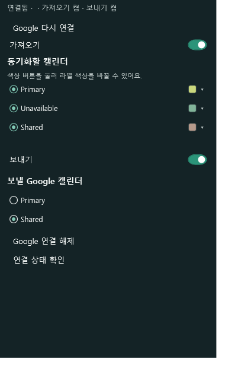
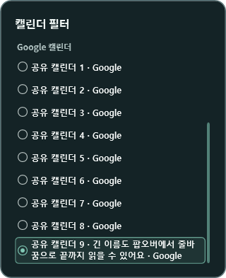
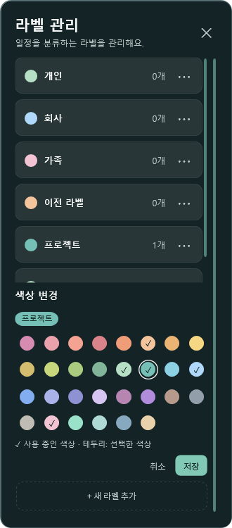

# Bystep 실제 화면 · 0.7.4 BETA

휴대폰에서 볼 수 있는 Windows 앱 실행 화면 캡처입니다. 컨셉 이미지가 아닙니다.
캘린더 이름과 일정 개수는 검증용 테스트 데이터입니다. 모바일 앱 화면을 뜻하지 않습니다.

사진을 누르거나 **원본 사진 열기**를 누르면 확대해 볼 수 있습니다.

## Google 캘린더 선택

원형 선택 표시와 이름을 세로 목록으로 배치했습니다. 캘린더 이름을 눌러 선택하며, 오른쪽 버튼에서 색상을 바꿉니다. 긴 목록은 내부 스크롤을 사용합니다.

가져오기는 여러 개 선택, 보내기는 기본 저장 캘린더 한 개 선택입니다.

[원본 사진 열기](https://raw.githubusercontent.com/frog8256/Aven-Downloads/main/screenshots/0.7.4-beta-r8/google-calendar-selection.png)

## 캘린더 필터 · 더보기

캘린더가 많을 때의 목록과 내부 스크롤입니다. 이 캡처는 Google 캘린더 구간으로 스크롤한 상태입니다.

[원본 사진 열기](https://raw.githubusercontent.com/frog8256/Aven-Downloads/main/screenshots/0.7.4-beta-r8/calendar-filter.png)

## 라벨 관리 · 색상 팔레트

리스트형 라벨 관리와 사용 중인 색상 체크 표시입니다.

[원본 사진 열기](https://raw.githubusercontent.com/frog8256/Aven-Downloads/main/screenshots/0.7.4-beta-r8/label-palette.png)

---

[Windows 배포 파일 받기](https://github.com/frog8256/Aven-Downloads/releases/tag/v0.7.4-beta-r8)

앱 표시 버전: **0.7.4 BETA** · 내부 업데이트 버전: **2.7.5.21**
